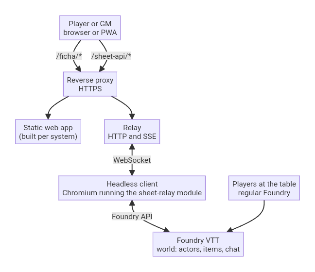
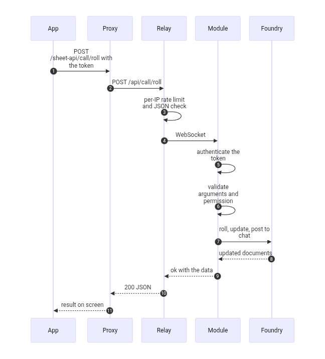
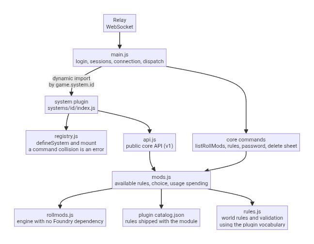
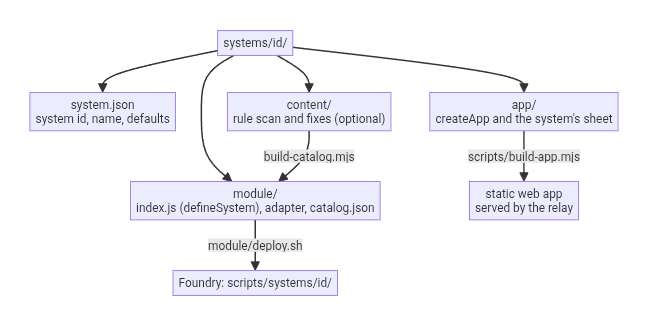

Português: [README.pt.md](README.pt.md)

# Sheet Relay

Companion character sheets for [Foundry VTT](https://foundryvtt.com) v13. Players and the GM open a mobile-friendly web app (also installable as a PWA) to view and edit characters, roll dice and use features, while everything is read and written in your real Foundry world.

It has three parts:

- **Foundry module** `sheet-relay` (`module/`): runs inside Foundry, validates every request, reads and writes actors, rolls in the Foundry chat.
- **Relay** (`relay/`): a small Node server that exposes an HTTP/SSE API to the app and forwards each call to the module over a WebSocket. It can also serve the built app.
- **Web app** (`systems/<id>/app` + `shared/`): the sheets (Expo / React Native Web), one app per game system, English and Portuguese (pt-BR).

## How it works

1. The browser only talks to the relay (HTTP, behind your HTTPS reverse proxy).
2. The relay forwards each call over a WebSocket to the `sheet-relay` module.
3. The module runs inside a Foundry client that stays logged in as a dedicated "relay user" (role Assistant GM): a browser tab, or a headless Chromium (`headless/`).
4. The module authenticates the app session token, validates arguments and permissions, then rolls, updates or posts to chat.
5. Each game system is a plugin in `systems/<id>/` (module side + app side); the core never changes.
6. Players at the table keep using normal Foundry; the companion app sees the same data.

The diagrams are in Portuguese (the labels are the only thing that is); the structure is the same as described here.

<p align="center"></p>
<p align="center"></p>
<p align="center"></p>
<p align="center"></p>

## Supported systems

| System id (`game.system.id`) | Status |
|---|---|
| `dnd5e` | Full plugin with SRD 5.2 roll rules in English (`catalog.json`, paraphrased from the SRD, CC-BY-4.0). |
| `fallout` (Fallout 2d20) | Integration code only. No rules text and no catalog shipped. You must own the game and the Foundry system. Bring your own catalog. |
| `legends` (Avatar Legends) | Integration code only. No rules text and no catalog shipped. You must own the game and the Foundry system. Bring your own catalog. |

A private catalog goes in `systems/<id>/module/catalog.private.json` (same format as `catalog.json`; it is optional and overrides the public entries). To support another system, see [docs/create-system.md](docs/create-system.md).

## Quick start A: Docker

Needs Docker with Compose, Foundry VTT v13 with your system and a world (the compose file can also run Foundry for you, profile `foundry`, if you have a Foundry licence).

```bash
cd docker
cp .env.example .env      # set SYSTEM, RELAY_SECRET (long random value), RELAY_USER, RELAY_PASSWORD, FOUNDRY_HOST
docker compose up -d      # relay + app + headless relay user
# optional: docker compose --profile foundry up -d   (also run a Foundry server)
# optional: docker compose --profile caddy up -d     (HTTPS in front, needs DOMAIN in .env)
```

Then, in Foundry:

1. Install the module: *Add-on Modules → Install Module → Manifest URL*
   `https://github.com/GabrielDiasMoraes/sheet-relay/releases/latest/download/module.json`
2. In your world, enable **Sheet Relay**.
3. Create the relay user: name = `RELAY_USER` (default `Relay`), role **Assistant GM**, password = `RELAY_PASSWORD`. Create an Actor folder for the player characters (default name `Players`) and put the sheets in it.
4. *Configure Settings → Sheet Relay*: **Relay URL** `ws://sheet:8787` (the compose service name; use `ws://localhost:8787` if the relay is not in the same Docker network), **Relay secret** = your `RELAY_SECRET`, **Relay user** = the user from step 3 (default `Relay`), **Players folder** = your folder name. Save and reload the world: the module connects as soon as the relay user is logged in. See [Configuration reference](#configuration-reference) for every option.
5. Open `http://localhost:8787/ficha/` (the path `/ficha/` is the default `BASE_PATH`) and pick a Foundry user. Accounts without an app password enter directly (the GM's trust decision); set one with `game.modules.get("sheet-relay").api.setPassword(userId, "password")` in the Foundry console, or users can change it in the app. The relay user is hidden from the app's user list.

The headless service logs the relay user in to Foundry at `FOUNDRY_URL` (see the comments in `docker/docker-compose.yml`). The image can also be built locally: `docker build -t sheet-relay .` (build args: `SYSTEMS`, `BASE_PATH`).

## Quick start B: npm (no Docker)

Needs Node.js 20+.

```bash
export RELAY_SECRET='a-long-random-value'
npx @gaabrielmooraes/sheet-relay serve --system dnd5e      # relay + app on http://127.0.0.1:8787/ficha/
```

Options: `--system dnd5e|fallout|legends`, `--port`, `--host`, `--base` (env `SYSTEM`, `PORT`, `HOST`, `BASE_PATH`). Keep the relay user connected to the world, either by logging it in from a browser tab you leave open, or headless:

```bash
npm i playwright && npx playwright install chromium
FOUNDRY_URL=http://localhost:30000 FOUNDRY_USER=Relay FOUNDRY_PASSWORD='...' \
  npx @gaabrielmooraes/sheet-relay headless
```

Install the module in Foundry from the manifest URL above, enable it, create the relay user (Assistant GM) and set **Relay URL** `ws://localhost:8787`, **Relay secret** (same as `RELAY_SECRET`) and **Players folder**, as in Quick start A.

## Quick start C: from source (development)

Needs Node.js 20+ and git.

```bash
git clone https://github.com/GabrielDiasMoraes/sheet-relay.git && cd sheet-relay
bash module/deploy.sh --local "<Foundry Data folder>"      # copies the module to <Data>/modules/sheet-relay; restart Foundry
(cd relay && npm install && RELAY_SECRET=dev node server.js)
(cd systems/dnd5e/app && npm install)
bash scripts/publish-app.sh dnd --local "<Foundry Data folder>" --serve   # typecheck, build, serve at http://localhost:8080/ficha/
```

`publish-app.sh` takes the app name from `systems/<id>/system.json` (`dnd`, `fallout`, `avatar`) or the system id. Foundry module settings are the same as above (`Relay URL` `ws://localhost:8787`). Full walkthrough: [docs/install.md](docs/install.md).

## Configuration reference

**Foundry module** (*Configure Settings → Sheet Relay*, world scope; the module only connects when the Foundry user named **Relay user** is logged in):

| Setting | Default | What it does |
|---|---|---|
| Relay URL (WebSocket) | `ws://localhost:8787` | Where the module reaches the relay, as seen **from the browser that runs the relay user** (the headless container). Docker compose: `ws://sheet:8787`. |
| Relay secret | empty | Must equal the relay's `RELAY_SECRET`. Empty = no secret (not recommended). |
| Foundry user that connects to the relay | `Relay` | Exact Foundry user name of the relay account (role Assistant GM). It is hidden from the app. |
| Players' characters folder | `Players` | Actor folder (and subfolders) the GM sees in the app; players always see their own characters. |
| Users hidden from the app | `Helper` | Comma-separated Foundry user names that cannot sign in to the app. |
| Module language | Auto | Language of chat messages sent by the module (Auto follows Foundry's language). |

**Relay / app container** (`ghcr.io/gabrieldiasmoraes/sheet-relay`, or `npx @gaabrielmooraes/sheet-relay serve`):

| Variable | Default | What it does |
|---|---|---|
| `SYSTEM` | `dnd5e` | App to serve: `dnd5e`, `fallout` or `legends` (must match your world's game system). |
| `RELAY_SECRET` | none | Shared secret checked when the module connects. Set it (compose requires it). |
| `PORT` / `HOST` | `8787` / `127.0.0.1` (`0.0.0.0` in the image) | Listen address. |
| `BASE_PATH` | `/ficha` | URL path the app is served under (fixed at build time in the image). |
| `TRUST_PROXY` | `0` (`1` in the image) | Trust `X-Forwarded-For` from a reverse proxy for rate limits. |

**Headless relay user** (`ghcr.io/gabrieldiasmoraes/sheet-headless`, or `npx @gaabrielmooraes/sheet-relay headless`):

| Variable | What it does |
|---|---|
| `FOUNDRY_URL` | Foundry address the headless browser opens. Keep `http://localhost:<port>` (a secure context, which the module needs) and map the real host with `FOUNDRY_HOST`. |
| `FOUNDRY_HOST` | Real host name of your Foundry server (compose service `foundry` if you use the profile). |
| `FOUNDRY_USER` / `FOUNDRY_PASSWORD` | The relay user's Foundry name and password. |

**Troubleshooting:** `curl http://localhost:8787/api/status` shows `503 Foundry disconnected` until the module is connected. If it stays that way: the relay user is not logged in (check the headless logs), **Relay user** does not match the Foundry user name, **Relay URL** is wrong from the headless browser's point of view, or **Relay secret** differs from `RELAY_SECRET`.

## Language

The app has an **EN / PT** switch (it starts in the browser language and remembers your choice). The Foundry module has a **Module language** setting (default: automatic, from the Foundry language). Both support English and Brazilian Portuguese; add more with `addLocale`.

## Security notes

- Set a long random `RELAY_SECRET` on the relay **and** in the module setting *Relay secret*. Without it, anyone who can reach the relay port can impersonate Foundry. The relay warns at startup when it is unset.
- The relay user is a GM-level Foundry account: give it a strong password and do not use it to play.
- The relay listens on `127.0.0.1` by default. For access from other devices, put it behind a **HTTPS reverse proxy** (the compose file has a Caddy profile) and set `TRUST_PROXY=1` so rate limits use the real client IP (the Docker image already sets it; do not set it when clients reach the relay directly).
- App sessions use tokens issued after a per-user app password; the module validates every argument and permission (only the owner or a GM can touch an actor) and never trusts the app.
- Do not commit your `.env`.

## Create a plugin for another system

Copy `systems/_template` to `systems/<game.system.id>/` and follow [docs/create-system.md](docs/create-system.md).

## For AI agents installing this

Do the steps in order; do not continue if a verification fails.

| # | Step | Inputs | Verify |
|---|---|---|---|
| 0 | Collect inputs | Foundry v13 URL, game system id (`dnd5e`, `fallout` or `legends`), relay user name and password, a generated `RELAY_SECRET` | the Foundry URL answers; system id is in the supported list |
| 1 | Start relay + app (Docker: `cd docker && cp .env.example .env`, fill it, `docker compose up -d`; or npm: `npx @gaabrielmooraes/sheet-relay serve --system <id>`) | `SYSTEM`, `RELAY_SECRET` | `curl http://localhost:8787/api/status` returns `{"ok":true,"system":"dnd5e","plugin":"dnd5e","api":1}` once Foundry is connected (HTTP 503 "Foundry disconnected" before that, which is expected until step 5) |
| 2 | Install the module from `https://github.com/GabrielDiasMoraes/sheet-relay/releases/latest/download/module.json` and enable it in the world | world, GM access | Sheet Relay appears under *Manage Modules* as active |
| 3 | Create the relay user (role Assistant GM, password) and an Actor folder for the players' characters | relay user, password, folder name | the user exists in *Configure Players* |
| 4 | Set module settings: Relay URL (`ws://sheet:8787` in Docker, `ws://localhost:8787` otherwise), Relay secret = `RELAY_SECRET`, Players folder | step 1 and 3 values | saved without error |
| 5 | Log the relay user in and keep it connected (headless service/command, or an open browser tab) | `FOUNDRY_URL`, user, password | `curl http://localhost:8787/api/status` returns `{"ok":true,"system":"dnd5e","plugin":"dnd5e","api":1}` (the `system` and `plugin` fields show your system id) |
| 6 | Open the app | none | `curl -I http://localhost:8787/ficha/` returns HTTP 200 |

If `/api/status` shows `plugin:null`, the system has no plugin in `systems/`; if it is disconnected, step 5 or the Relay URL / secret is wrong.

## Licenses

- Code: MIT, see [LICENSE](LICENSE).
- The D&D 5e roll-rule catalog paraphrases the **System Reference Document 5.2** by Wizards of the Coast LLC, licensed under [CC BY 4.0](https://creativecommons.org/licenses/by/4.0/legalcode). Attribution and full notices: [NOTICE](NOTICE).
- Foundry Virtual Tabletop, Dungeons & Dragons, Fallout and Avatar Legends are trademarks of their respective owners. This project is unofficial and not affiliated with or endorsed by any of them. The Fallout and Avatar Legends plugins contain only integration code; you must own the games and systems you use them with.

## Contributing

Issues and pull requests are welcome. Before sending a change, run `bash scripts/check.sh` (module and relay tests, catalog check, system manifests, typecheck of the apps; `--rapido` skips the typecheck). Do not add copyrighted rules text to the public catalogs.
