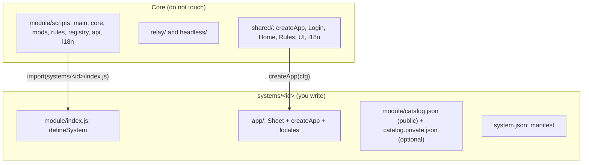

# Creating a plugin for a new game system

This repository is the **core**; each game system is a **plugin** in `systems/<id>/`, where `<id>` is exactly Foundry's `game.system.id` (`dnd5e`, `fallout`, `legends`...). The core loads the plugin by the world's system id; you do not edit any core file.



## 1. Layout

```
systems/<id>/
  system.json            manifest (name, app, ...; used by the publish scripts)
  module/index.js        defineSystem({...}); imports ONLY ../../api.js
  module/<id>.js         the system's commands (handlers)
  module/locales.js      plugin texts: { en: {...}, "pt-BR": {...} }   (optional but recommended)
  module/catalog.json    public roll rules (generated; may be {})
  module/catalog.private.json   optional private overlay (never published)
  content/fixes.mjs      catalog generator tweaks (optional)
  app/                   Expo app (createApp + Sheet + locales/en.json, pt-BR.json)
```

## 2. Step by step

1. `cp -r systems/_template systems/<id>` and replace `template` with your id in `system.json`, `module/index.js` and `app/` (package, `app.json`). **The folder name and the descriptor `id` must equal `game.system.id`.**
2. **Manifest** (`system.json`): `id, name, app` (short publish name, e.g. `dnd`), `instance`, `container`, `domain`, `relayUser`, `web`, `mcpPort` (unique per system). `node scripts/check-systems.mjs` checks them against the hand-written infrastructure files that exist in your checkout. Fill them with your own values; the Docker image and the npm package only need the `id`.
3. **Module plugin** (`module/index.js`):
   ```js
   import { defineSystem } from "../../api.js";
   import * as t from "./mysystem.js";
   import locales from "./locales.js";

   export default defineSystem({
     id: "mysystem", api: 1,
     locales,                              // { en: { "my.key": "text {x}" }, "pt-BR": {...} }
     listedTypes: ["character"],           // actor types the app lists
     summary: (a) => ({ id: a.id, name: a.name }),    // list row
     handlers: { getCharacter, update, roll },        // commands the app calls
     overrides: [],                        // core handler names you replace (see section 3)
     catalogUrl: new URL("./catalog.json", import.meta.url).href,
     rulePacks: [], ruleItemTypes: [],     // rules editor: compendiums and item types
     vocab: { rolls: [], itemFilters: [], effects: [], costs: [], periods: [] }, // what you add to the rules vocabulary
     modContext, modPreview,               // when your rolls accept modifiers (step 6)
     register() {}                         // Foundry hooks (Hooks.on...) run here, not at load time
   });
   ```
4. **Texts and errors**: use `tr(key, params)` and `fail(status, key, params)` from `../../api.js`. `fail` builds an `Error` whose message is `tr(key, params)` and keeps `status`, `key`, `params`, so the app can translate it too. Keys are flat strings; `{name}` is replaced by `params.name`; an unknown key returns the key itself, and a missing `pt-BR` entry falls back to `en`. Prefix your keys with the system id (`dnd.err.noUses`) to avoid clashing with core keys (`err.*`, `set.*`, `mod.*`...). The core registers `descriptor.locales.en` and `.["pt-BR"]` at load time; at least provide `en`.
5. **Commands**: `async (user, args) => result`. Use `ownedActor(user, actorId)` (only the owner or a GM passes), `fail(status, key, params)`, `pick(value, default, min, max, label)`, `text()` (HTML to text), `esc()` (escape HTML for chat). The relay is a GM-level user, so **validate everything** the app sends and update only fields from a fixed list. Start with `getCharacter`, `update` and `roll` (the contract test requires them).
6. **Roll modifiers (optional)**: implement `modContext(actor, args)` returning `{ roll, skill?, attribute?, item?, itemFilter?, ... }` and use `availableMods`, `chooseMods`, `spendUses`, `announceMods` (all in `api.js`) inside your `roll`. The engine (`rollmods.js`) is pure and identical for all systems; **the meaning of the effects is yours** (`add`, `advantage`...): you interpret them in the roll. New rule words go in `vocab`; the editor and validation then accept them.
7. **Catalog** (optional): `catalog.json` is the public roll-rule catalog loaded from `catalogUrl`; `catalog.private.json` next to it is an optional private overlay (same format, its entries override the public ones; a missing or invalid file counts as `{}`). Only put rules text you are allowed to redistribute in the public file. To generate it, put source rules in `systems/<id>/content/<prefix>_<n>.json`, a `fixes.mjs` with `export const prefix`, and run `node content/roll-mods/build-catalog.mjs` (`--check` verifies it). If your system's rules are not freely licensed, ship `catalog.json` as `{}` and let users bring their own `catalog.private.json`.
8. **App** (`app/`): `App.tsx` is `export default createApp({ ui, labels, row, Sheet, rules?, screens?, Create?, Master? })`. Login, list, password, delete, "new version" and the rules editor come from the core. You write `Sheet` and optionally `Create` / `Master`; `screens: { Login, Home }` replaces whole screens. Call the relay with `rpc("command", args)` from `shared/api-core.ts`. Register your texts with `addLocale` from `shared/i18n` and read them with `t(key, params)`:
   ```ts
   import { addLocale, t } from "../../../shared/i18n";
   import en from "./locales/en.json";
   import ptBR from "./locales/pt-BR.json";
   addLocale("en", en);
   addLocale("pt-BR", ptBR);
   ```
   The language switch (EN / PT) is built in: `useLang()` returns `[lang, setLang]` and re-renders on change. First time: `cd app && npm install`.
9. **Validate**: `bash scripts/check.sh` runs the module tests (including the contract test), the relay tests, the catalog check, the manifest check and the typecheck of every app that has `node_modules` (`--rapido` skips the typecheck). The contract test (`module/test/contract.test.mjs`) loads your plugin **without** Foundry: it checks the descriptor format, that the required commands exist, that there is no collision with core commands, and that the plugin only imports `../../api.js` or its own folder. So no `game`, `ui` or `foundry.*` at file level (only inside functions or `register`). When you add or remove commands on purpose, update the snapshot in that test.
10. **Install**: see [install.md](install.md). Check `GET /api/status` returns `plugin:"<id>"`.

## 3. Override (replacing a core behaviour)

A handler with the **same name** as a core one is an error (`mount` throws) unless the name is listed in `overrides`. Then your function receives the core version as the 3rd argument (decorator):
```js
overrides: ["roll"],
handlers: { roll: async (user, args, core) => { /* before */ const r = await core(user, args); /* after */ return r; } }
```
`login` and `listUsers` cannot be overridden (security).

## 4. Pitfalls

- `id`, `type` and `token` are **reserved** by the relay (stripped from the body): use `actorId`, `kind`, etc.
- The request body is limited to 64 KB (413).
- No Foundry globals at module load; the plugin is imported during `init`, before the game exists.
- Import only from `../../api.js`; the contract test rejects other paths.
- Changing the module id or `esmodules` requires restarting Foundry: do not.
- Effects/rules unknown to `vocab` are rejected by `saveRules`: declare them in `vocab`.
- Do not rename existing `sheet-relay` flags or settings (data already stored).

## 5. Testing

- Offline: `bash scripts/check.sh`.
- With Foundry: install from source (`module/deploy.sh --local <Data>`), open the app, `curl http://localhost:8787/api/status`. `game.modules.get("sheet-relay").api` in the Foundry console lets you call the commands directly. Delete any test data when you finish.

## 6. Checklist

- [ ] folder = `game.system.id`; `system.json` filled in
- [ ] `getCharacter`, `update`, `roll` validate input and use `ownedActor`
- [ ] plugin only imports `../../api.js`; no globals at load time
- [ ] texts go through `tr()` / `fail(status, key, params)`, with `en` (and ideally `pt-BR`) locales in the plugin and the app
- [ ] no copyrighted rules text in the public `catalog.json`
- [ ] `check.sh` green
- [ ] `/api/status` shows the plugin; login, list, sheet and one roll work in the app
